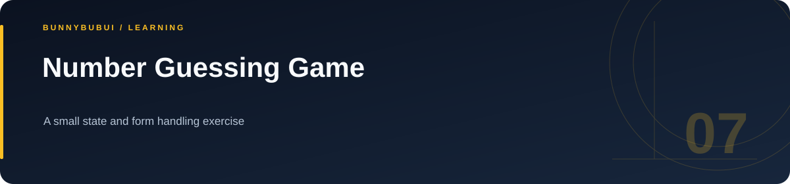

<p align="center">
  
</p>

<h1 align="center">Number Guessing Game</h1>

<p align="center">A small state and form handling exercise</p>

<p align="center">
     
</p>

<p align="center"><a href="#overview">ภาพรวม</a> · <a href="#features">ความสามารถ</a> · <a href="#start">เริ่มใช้งาน</a> · <a href="#structure">โครงสร้าง</a> · <a href="#validation">ตรวจสอบงาน</a></p>

<a id="overview"></a>

## ภาพรวม

เกมทายตัวเลขขนาดเล็กสำหรับฝึก React state การรับค่าจากฟอร์ม การสุ่มตัวเลข และการแสดงผลใน dialog

<a id="features"></a>

## ความสามารถที่มีใน source

| ส่วนงาน | รายละเอียด | อ้างอิง |
|---|---|---|
| **Form state** | รับค่าตัวเลขและตรวจช่วงที่กำหนด | [ดู source](src/App.jsx) |
| **Game feedback** | สุ่มตัวเลขและแสดงผลการทาย | [ดู source](src/App.jsx) |

<a id="start"></a>

## เริ่มต้นใช้งาน

**สิ่งที่ต้องมี:** Node.js และ npm

```sh
npm ci
npm run dev
```

คำสั่งนี้เปิดส่วนที่มี package.json ของตนเอง; ดู scripts ใน package สำหรับ build และ lint ที่มีอยู่

<a id="structure"></a>

## โครงสร้างที่ควรเริ่มอ่าน

| ตำแหน่ง | หน้าที่ |
|---|---|
| [src/](src) | source ของแอป |

<a id="validation"></a>

## คำสั่งและผลตรวจ

| โฟลเดอร์ที่รัน | คำสั่งที่มีใน package |
|---|---|
| `.` | `npm run build` |
| `.` | `npm run lint` |

<a id="scope"></a>

## ขอบเขตของงาน

เป็นแบบฝึกหัด state และ form handling เหมาะสำหรับอธิบายพื้นฐาน React

<a id="reading"></a>

## อ่านต่อ

- [บันทึกการเตรียม source](docs/CLEANUP.md)


---

<p align="center"><a href="https://github.com/BunnyBubui">BunnyBubui</a> · <a href="https://github.com/BunnyBubui/test">Software Portfolio</a></p>
